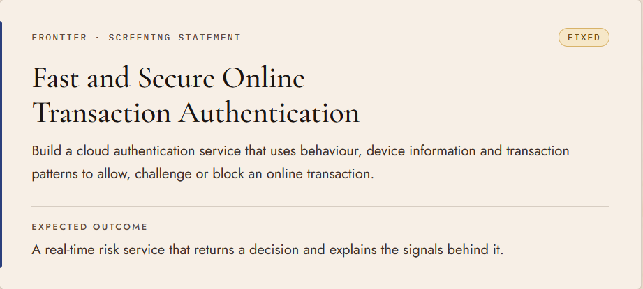

# Problem statement

**Track:** Frontier · Screening statement · **Type:** Fixed
**Title:** Fast and Secure Online Transaction Authentication

## Official text (verbatim)
> Build a cloud authentication service that uses behaviour, device information and transaction patterns to allow, challenge or block an online transaction.
>
> **Expected outcome:** A real-time risk service that returns a decision and explains the signals behind it.

## Our reading: what the judges will look for
| Phrase in statement | What it means for us |
|---|---|
| "cloud authentication service" | A deployed API (with a public URL), not just a notebook |
| "behaviour" | Session behaviour: typing/click cadence, time from login to pay, navigation pattern, velocity |
| "device information" | Device fingerprint, new vs known device, IP/geo, VPN/emulator flags |
| "transaction patterns" | Amount vs user history, merchant/category novelty, time of day, frequency |
| "allow, challenge or block" | Three-way decision with tunable thresholds. "Challenge" means step-up (OTP/biometric) |
| "Fast" / "real-time" | Measure and show latency (target p95 < 100 ms) |
| "explains the signals" | Every decision returns human-readable reasons and per-signal contributions |

## Open questions
- Is a deployed demo mandatory, or is a video enough?
- Are datasets provided, or do we bring our own?
